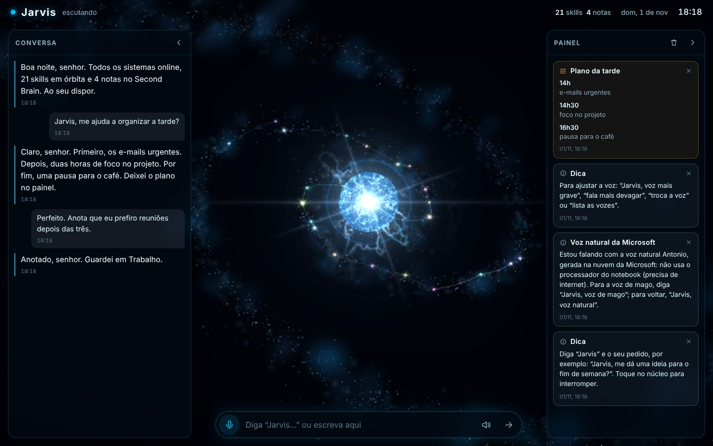
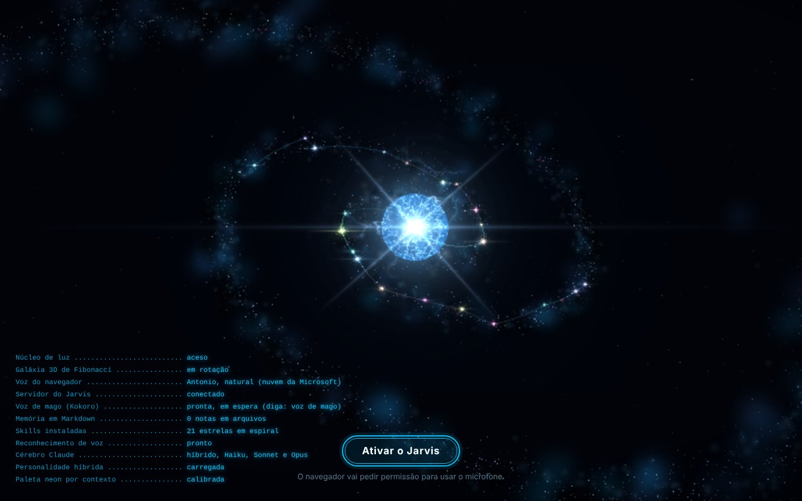
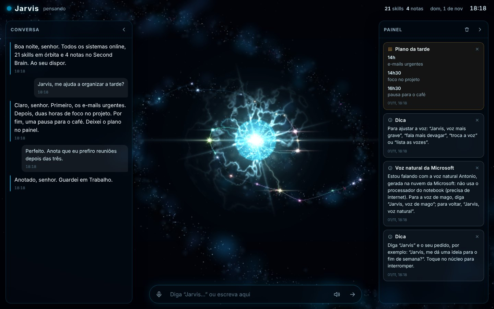
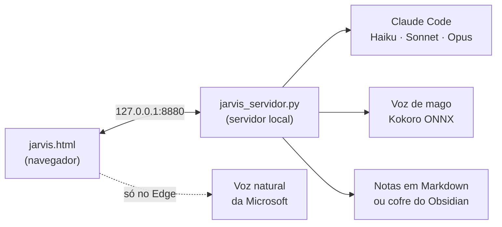

# Jarvis

Assistente de voz pessoal que roda no navegador, inspirado no Jarvis do Homem de Ferro. Você fala "Jarvis" e o seu pedido. Ele responde em voz alta, com o Claude como cérebro. Ele também guarda o que sabe sobre você num Second Brain, desenhado como uma galáxia 3D.



## O que ele faz

- **Conversa por voz:** a palavra de ativação é "Jarvis", em qualquer ponto da frase. Depois de responder, ele continua ouvindo por alguns segundos, sem você precisar repetir o nome.
- **Cérebro híbrido:** o Claude Haiku responde o simples, o Sonnet o complexo e o Opus o que pede raciocínio profundo. Com o servidor local, os três rodam no Claude Code, na sua assinatura do Claude. Sem o servidor, ele usa uma chave da API.
- **Second Brain:** notas sobre você, sua rotina e seus projetos, usadas para personalizar cada resposta.
  - Para ensinar algo, é só falar: "Jarvis, anota que...".
  - As notas viram arquivos Markdown, ou vão para o seu cofre do Obsidian, se você tiver um.
- **Galáxia 3D:** uma espiral de Fibonacci em WebGL puro, com uma estrela para cada skill instalada no seu Claude Code. No centro fica um núcleo de plasma que muda de cor conforme o assunto e solta raios enquanto pensa.
- **Duas vozes:**
  - **No Microsoft Edge:** a voz natural da Microsoft (Antonio), gerada na nuvem. Não gasta o processador.
  - **Voz de mago (Kokoro):** gratuita, roda no seu computador.
- **Painéis:** a conversa fica à esquerda. À direita, um painel de avisos mostra as notícias do dia, as fontes das pesquisas e os alertas importantes.
- **Sem frameworks:** um único arquivo HTML, sem CDNs e sem bibliotecas externas.

| Inicialização | Pensando |
|---|---|
|  |  |

## Como funciona



- **A página** (`jarvis.html`) cuida da tela, do microfone, da voz e das notas.
- **O servidor** (`jarvis_servidor.py`, em Python, sem dependências obrigatórias) liga a página ao Claude Code, gera a voz de mago e guarda as notas.

## Requisitos

- Windows 10 ou 11. O servidor também roda em Linux e macOS, mas o instalador é só para Windows.
- Uma assinatura do Claude com o Claude Code, ou uma chave da API da Anthropic.
- O Microsoft Edge, para a voz natural. O Chrome também funciona, com a voz do Windows ou a voz de mago.
- O resto, o instalador baixa sozinho.

## Instalação (Windows)

1. Baixe o projeto em **Code → Download ZIP** e descompacte, ou clone com `git clone https://github.com/Allan-Marques/jarvis`.
2. Na pasta do projeto, abra o PowerShell e rode:

   ```powershell
   powershell -ExecutionPolicy Bypass -File .\instalar-jarvis.ps1 -SoJarvis
   ```

   Com `-SoJarvis`, o instalador prepara só o que o Jarvis precisa:
   - Git e Python 3.12;
   - o Claude Code;
   - a voz de mago (uns 190 MB, baixados uma única vez);
   - o servidor;
   - o ícone **Jarvis** na área de trabalho.

   Sem esse parâmetro, ele também configura um ambiente completo no Claude Code. É a configuração usada pelo autor:
   - Graphify;
   - os comandos `/jarvis` e `/jarvis-sys`;
   - as regras no `CLAUDE.md`;
   - as Anthropic Skills e o Claude-Mem;
   - os servidores MCP.

   O instalador não apaga nada.
3. Se for a primeira vez com o Claude Code, ele abre uma janela para você entrar na sua conta.
4. Para usar, dê dois cliques no ícone **Jarvis** da área de trabalho. O Jarvis abre numa janela do Edge e pede o microfone uma vez.

Outras opções do instalador:
- `-Cofre "C:\caminho\do\cofre"`: guarda as notas no seu cofre do Obsidian.
- `-SemKokoro`: pula a voz de mago.

**Sem instalar nada:** abra o `jarvis.html` direto no Chrome ou no Edge e cole uma chave da API quando ele pedir. Assim você tem a conversa, a galáxia e as notas, mas não a voz de mago, as skills e as ferramentas do Claude Code.

**Em Linux ou macOS:**
1. Instale o Claude Code.
2. Para a voz de mago, rode `pip install kokoro-onnx`.
3. Inicie com `python3 jarvis_servidor.py --abrir`.

## Personalize

Abra o `jarvis.html` num editor de texto e procure por **PERFIL**, no começo do script. É a única parte que você precisa mudar:

| Campo | O que é |
|---|---|
| `assistente` | Nome do assistente. Também é a palavra de ativação. |
| `usuario` e `formal` | Como ele te chama no dia a dia ("senhor", seu nome, "chefe") e o tratamento formal. |
| `nomeCompleto` e `cidade` | Opcionais. A cidade serve para as notícias da sua região. |
| `especiais` | Títulos por assunto. Exemplo: "Doutora" em assuntos de medicina. |
| `personalidade` | As regras de personalidade. O padrão é híbrido: mordomo britânico no trabalho, descontraído no dia a dia, sarcástico só em pitadas. |
| `TEMAS` | A cor que o núcleo assume em cada assunto. |
| `HUBS` e `NOTAS` | As áreas e as notas do seu Second Brain. |

Os ajustes de voz e de tela também podem ser feitos falando, como mostra a tabela abaixo.

## Comandos de voz

Comece qualquer comando com "Jarvis".

| Diga | Para |
|---|---|
| "anota que..." / "guarda isso: ..." | Criar uma nota no Second Brain |
| "voz natural" / "voz de mago" / "voz do navegador" | Trocar a voz |
| "voz mais grave", "fala mais devagar", "mais eco", "troca a voz", "testa as vozes" | Ajustar a voz |
| "modo rápido" / "modo completo" / "modo máximo" / "modo automático" | Escolher o modelo do cérebro |
| "pensa com calma..." / "analisa a fundo..." | Usar o Opus só nessa pergunta |
| "nova conversa" | Começar do zero |
| "mostra as notas" / "mostra as skills" | Mudar o que as estrelas representam |
| "gráficos leves" / "gráficos normais" / "gráficos no máximo" | Ajustar a galáxia ao seu computador |
| "congela a galáxia" / "gira a galáxia" | Parar ou girar a galáxia |
| "esconde a conversa" / "mostra o painel" / "limpa o painel" | Organizar a tela |
| "atualiza as notícias" | Buscar as notícias do dia |

Para interromper uma resposta, toque no núcleo de luz.

## Privacidade

- **As notas e a voz de mago** ficam no seu computador.
- **As suas perguntas** vão para a Anthropic, pelo Claude Code ou pela API.
- **O reconhecimento de voz** é feito pelo serviço do navegador: o do Google no Chrome, o da Microsoft no Edge.
- **A voz natural do Edge** é gerada nos servidores da Microsoft.

O Jarvis não tem telemetria.

## Créditos

- [Claude e Claude Code](https://www.anthropic.com/claude-code), da Anthropic: o cérebro.
- [Kokoro-82M](https://huggingface.co/hexgrad/Kokoro-82M), de hexgrad (Apache-2.0), e [kokoro-onnx](https://github.com/thewh1teagle/kokoro-onnx), de thewh1teagle (MIT): a voz de mago.
- [ONNX Runtime](https://onnxruntime.ai), da Microsoft: roda a voz no processador.
- As vozes naturais do Microsoft Edge.

O projeto começou com o prompt em [PROMPT.md](PROMPT.md) e foi crescendo conversa a conversa.

## Licença

[MIT](LICENSE).
